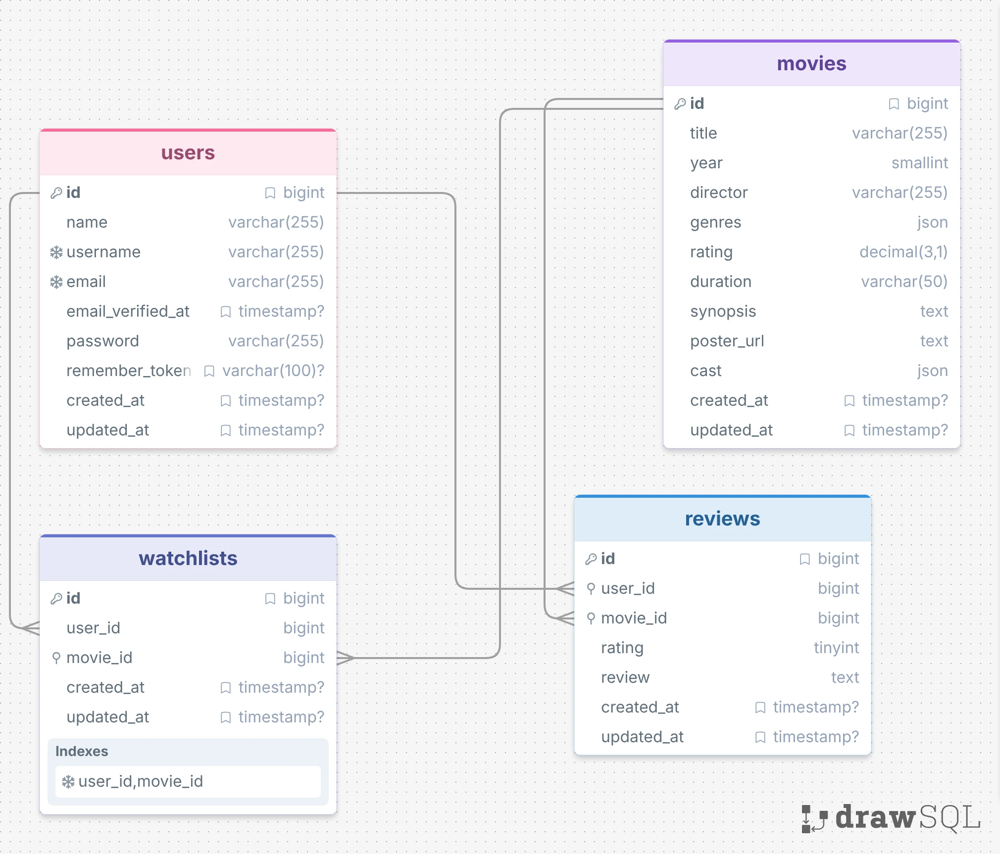

# FilmLog Database Documentation

## 1. Database Overview

FilmLog uses MySQL as its relational database management system (RDBMS). The database stores user account information, movie catalog data, personal watchlists, and user-submitted reviews.

The database consists of four main application tables:

- `users`: Stores registered user account information.
- `movies`: Stores movie information, including titles, genres, ratings, and other metadata.
- `watchlists`: Stores the movies added to each user's personal watchlist.
- `reviews`: Stores ratings and written reviews submitted by users.

The database uses the InnoDB storage engine with the `utf8mb4` character set and `utf8mb4_unicode_ci` collation.

Primary keys, foreign keys, unique constraints, and indexes are implemented to maintain data integrity and support data retrieval.

## 2. Entity Relationship Diagram

The following Entity Relationship Diagram (ERD) illustrates the structure of the FilmLog database, including its entities, attributes, and relationships.

## 3. Database Tables

This section describes the structure, attributes, and constraints of each application table in the FilmLog database.

### 3.1. Users Table

The `users` table stores information about registered user accounts.

| Column | Data Type | Constraint | Description |
|---|---|---|---|
| id | BIGINT UNSIGNED | Primary Key, Auto Increment | Unique identifier for each user. |
| name | VARCHAR(255) | NOT NULL | Stores the same value as `username` during registration. |
| username | VARCHAR(255) | NOT NULL, UNIQUE | Stores the user's unique username. |
| email | VARCHAR(255) | NOT NULL, UNIQUE | Stores the user's email address. |
| email_verified_at | TIMESTAMP | NULL | Stores the timestamp when the user's email was verified, if applicable. |
| password | VARCHAR(255) | NOT NULL | Stores the user's hashed password. |
| remember_token | VARCHAR(100) | NULL | Reserved for Laravel's remember-me functionality. The current JWT authentication flow does not rely on this column. |
| created_at | TIMESTAMP | NULL | Stores the timestamp when the record was created. |
| updated_at | TIMESTAMP | NULL | Stores the timestamp when the record was last updated, if an update operation occurs. |

During registration, the backend assigns the submitted username to both the `name` and `username` columns. Therefore, these columns contain the same value when a user account is initially created.

The `password` column stores a hashed password through Laravel's password hashing mechanism rather than the original plain-text password.

### 3.2. Movies Table

The `movies` table stores the movie catalog and its associated metadata.

| Column | Data Type | Constraint | Description |
|---|---|---|---|
| id | BIGINT UNSIGNED | Primary Key, Auto Increment | Unique identifier for each movie. |
| title | VARCHAR(255) | NOT NULL | Stores the movie title. |
| year | SMALLINT UNSIGNED | NOT NULL | Stores the movie's release year. |
| director | VARCHAR(255) | NOT NULL | Stores the movie director's name. |
| genres | JSON | NOT NULL | Stores the movie's genre data in JSON format. |
| rating | DECIMAL(3,1) | NOT NULL | Stores the movie rating provided in the catalog. |
| duration | VARCHAR(50) | NOT NULL | Stores the movie duration. |
| synopsis | TEXT | NOT NULL | Stores a description of the movie's storyline. |
| poster_url | TEXT | NOT NULL | Stores the URL of the movie poster. |
| cast | JSON | NOT NULL | Stores the movie's cast data in JSON format. |
| created_at | TIMESTAMP | NULL | Stores the timestamp when the record was created. |
| updated_at | TIMESTAMP | NULL | Stores the timestamp when the record was last updated, if an update operation occurs. |

The `genres` and `cast` columns use the JSON data type to store multiple pieces of movie-related information within a single column. This avoids the need for separate tables for these attributes in the current database design.

The `rating` column represents the rating stored in the movie catalog. It is separate from the ratings submitted by individual users in the `reviews` table.

### 3.3. Watchlists Table

The `watchlists` table stores the relationship between users and movies added to their personal watchlists.

| Column | Data Type | Constraint | Description |
|---|---|---|---|
| id | BIGINT UNSIGNED | Primary Key, Auto Increment | Unique identifier for each watchlist entry. |
| user_id | BIGINT UNSIGNED | Foreign Key, NOT NULL | References the user who added the movie. |
| movie_id | BIGINT UNSIGNED | Foreign Key, NOT NULL | References the movie added to the watchlist. |
| created_at | TIMESTAMP | NULL | Stores the timestamp when the entry was created. |
| updated_at | TIMESTAMP | NULL | Stores the timestamp when the record was last updated, if an update operation occurs. |

The table uses a composite unique constraint on `user_id` and `movie_id`. This prevents the same movie from being added more than once by the same user while allowing the movie to appear in different users' watchlists.

The application also checks for an existing entry before inserting a new watchlist record.

### 3.4. Reviews Table

The `reviews` table stores ratings and written reviews submitted by users for movies.

| Column | Data Type | Constraint | Description |
|---|---|---|---|
| id | BIGINT UNSIGNED | Primary Key, Auto Increment | Unique identifier for each review. |
| user_id | BIGINT UNSIGNED | Foreign Key, NOT NULL | References the user who submitted the review. |
| movie_id | BIGINT UNSIGNED | Foreign Key, NOT NULL | References the movie being reviewed. |
| rating | TINYINT UNSIGNED | NOT NULL | Stores the rating submitted by the user. The application validates this value as an integer between 1 and 5. |
| review | TEXT | NOT NULL | Stores the written review submitted by the user. |
| created_at | TIMESTAMP | NULL | Stores the timestamp when the review was created. |
| updated_at | TIMESTAMP | NULL | Stores the timestamp when the record was last updated, if an update operation occurs. |

The `rating` column in this table represents an individual user's rating, which is different from the catalog rating stored in `movies.rating`.

The database does not define a `CHECK` constraint or a composite unique constraint on `user_id` and `movie_id` for this table. Consequently, the database allows multiple review records for the same user and movie combination. The application validates each submitted rating to ensure that it is an integer between 1 and 5.

## 4. Database Relationships

The FilmLog database uses one-to-many relationships between its main entities. The `watchlists` and `reviews` tables serve as associative entities connecting users and movies.

### 4.1. Users and Watchlists

One user can have multiple watchlist entries, while each watchlist entry belongs to exactly one user.

- Relationship: One-to-Many.
- Primary Key: `users.id`.
- Foreign Key: `watchlists.user_id`.

### 4.2. Movies and Watchlists

One movie can appear in multiple users' watchlists, while each watchlist entry references exactly one movie.

- Relationship: One-to-Many.
- Primary Key: `movies.id`.
- Foreign Key: `watchlists.movie_id`.

### 4.3. Users and Reviews

One user can submit multiple reviews, while each review belongs to exactly one user.

- Relationship: One-to-Many.
- Primary Key: `users.id`.
- Foreign Key: `reviews.user_id`.

### 4.4. Movies and Reviews

One movie can have multiple review records, while each review references exactly one movie.

- Relationship: One-to-Many.
- Primary Key: `movies.id`.
- Foreign Key: `reviews.movie_id`.

Because the database does not enforce a unique constraint on the combination of `user_id` and `movie_id` in the `reviews` table, multiple reviews from the same user for the same movie are possible at the database level.

### 4.5. Referential Integrity

The database uses foreign key constraints with `ON DELETE CASCADE` for the relationships between users, movies, watchlists, and reviews.

This means that:

- When a user is deleted, their associated watchlist entries and reviews are automatically deleted.
- When a movie is deleted, its associated watchlist entries and reviews are automatically deleted.

These constraints help maintain referential integrity and prevent orphaned records.

## 5. Constraints and Indexes

The database implements several constraints and indexes to maintain data consistency and support data retrieval.

### 5.1. Primary Keys

Each table has an auto-incrementing primary key named `id`.

| Table | Primary Key |
|---|---|
| users | id |
| movies | id |
| watchlists | id |
| reviews | id |

### 5.2. Foreign Keys

Foreign keys maintain valid relationships between the tables.

| Table | Foreign Key | References | On Delete |
|---|---|---|---|
| watchlists | user_id | users.id | CASCADE |
| watchlists | movie_id | movies.id | CASCADE |
| reviews | user_id | users.id | CASCADE |
| reviews | movie_id | movies.id | CASCADE |

All foreign key columns are defined as `NOT NULL`.

### 5.3. Unique Constraints

The database applies unique constraints to prevent duplicate values in specific columns and combinations.

| Table | Unique Constraint | Purpose |
|---|---|---|
| users | email | Ensures that each email address belongs to only one user account. |
| users | username | Ensures that each username is unique. |
| watchlists | user_id, movie_id | Prevents the same movie from being added more than once by the same user. |

The `reviews` table does not have a composite unique constraint on `user_id` and `movie_id`. Therefore, multiple review records for the same user and movie combination are permitted by the database.

### 5.4. Indexes

The following indexes are defined in the current database schema.

| Table | Index Type | Columns |
|---|---|---|
| users | Primary Key | id |
| users | Unique Index | email |
| users | Unique Index | username |
| movies | Primary Key | id |
| watchlists | Primary Key | id |
| watchlists | Composite Unique Index | user_id, movie_id |
| watchlists | Foreign Key Index | movie_id |
| reviews | Primary Key | id |
| reviews | Foreign Key Index | movie_id |
| reviews | Index | user_id |

The composite unique index on `watchlists` uses `user_id` as its leading column. Therefore, it also supports queries that filter by `user_id`, without requiring a separate index on that column.

The `movies` table does not have additional indexes on `title` or `genres` in the current schema.

### 5.5. Data Integrity Rules

In addition to database-level constraints, the application implements validation rules to maintain data consistency.

- Usernames and email addresses must be unique during registration.
- Passwords must contain at least eight characters during registration.
- Passwords are stored in hashed form.
- A movie must exist before it can be added to a watchlist or reviewed.
- Review ratings must be integers between 1 and 5.
- A user cannot add the same movie to their watchlist more than once.

These rules are enforced through application-level validation, database constraints, or both, depending on the rule.

## 6. Database Design Decisions

This section explains the main design considerations behind the FilmLog database structure.

### 6.1. Relational Database

MySQL was selected as the database management system because FilmLog requires structured data storage and clear relationships between users, movies, watchlists, and reviews.

The relational model provides primary keys, foreign keys, and constraints to maintain data consistency.

### 6.2. Separation of Data Entities

The database separates user information, movie information, watchlist entries, and reviews into different tables.

This structure reduces unnecessary data duplication and makes it easier to manage relationships between users and movies.

For example, movie information is stored once in the `movies` table rather than being duplicated in every user's watchlist or review.

### 6.3. Use of JSON Data Type

The `genres` and `cast` columns in the `movies` table use the JSON data type to store movie-related information.

This approach allows multiple genre and cast values to be stored within a single column without requiring separate relational tables for these attributes.

The application also uses MySQL's JSON functionality to filter movies by genre.

### 6.4. Separation Between Movie Rating and User Reviews

The database separates catalog movie ratings from individual user reviews.

The `movies.rating` column stores the rating associated with a movie in the catalog, while `reviews.rating` stores ratings submitted by individual users.

This separation allows catalog information and user-generated content to be managed independently.

### 6.5. Composite Unique Constraint on Watchlists

The `watchlists` table uses a composite unique constraint on `user_id` and `movie_id`.

This ensures that each user can add a particular movie only once to their watchlist while allowing the same movie to appear in different users' watchlists.

The application also performs a duplicate check before creating a new watchlist entry.

### 6.6. Cascading Delete

Foreign key constraints use `ON DELETE CASCADE` to automatically remove related records when a referenced user or movie is deleted.

This helps maintain database consistency and prevents orphaned records.

### 6.7. No Separate Statistics and Recommendation Tables

FilmLog does not use separate database tables to store personal movie statistics or Gemini recommendation results.

Personal statistics are calculated dynamically using existing records from the `watchlists`, `reviews`, and `movies` tables.

Similarly, movie recommendations are generated using the local movie catalog and Gemini. The recommendation results are returned to the user without being stored in a separate recommendation history table.

This approach avoids storing additional derived or temporary data in the database.

## 7. Application-Level Database Operations

Some application features use existing database records to produce additional information without requiring additional tables.

### 7.1. Personal Movie Statistics

The statistics endpoint retrieves data belonging to the currently authenticated user and calculates the following values:

- `watchlist_count`: The total number of entries in the `watchlists` table belonging to the authenticated user.
- `watched_count`: The number of unique movies associated with the user's review records.
- `average_rating`: The average of all rating values in the authenticated user's review records, rounded to one decimal place. Returns `null` if the user has no reviews.
- `favorite_genre`: The genre that appears most frequently across the unique movies reviewed by the user. Returns `null` if no genre can be obtained from the reviewed movies.

The `watched_count` calculation counts unique movie IDs, so multiple reviews for the same movie do not increase this value.

In contrast, `average_rating` is calculated using all review records belonging to the user. Therefore, multiple reviews for the same movie are included separately in the average calculation.

The `favorite_genre` calculation uses the genres of unique reviewed movies, counting the occurrences of each genre across those movies.

These statistics are calculated when the endpoint is accessed using data from the existing `watchlists`, `reviews`, and `movies` tables. The results are not stored in a separate statistics table.

### 7.2. Gemini Movie Recommendation

The recommendation feature retrieves the movie catalog from the local `movies` table and sends movie information to Gemini along with the user's preference prompt.

The backend provides the following movie attributes to Gemini:

- Movie ID.
- Title.
- Release year.
- Genres.
- Director.
- Synopsis.

Gemini is instructed to select exactly one movie from the provided catalog and return its `movie_id` and `reasoning` in JSON format.

After receiving the response, the backend performs several validation steps:

1. Checks whether the response contains valid JSON.
2. Checks whether `movie_id` is an integer.
3. Checks whether `reasoning` is a non-empty string.
4. Verifies that the returned `movie_id` belongs to a movie retrieved from the local database.

If the response is invalid or the selected movie ID does not belong to the local catalog, the backend does not return it as a valid recommendation.

The backend validates the response structure and the selected movie's existence in the local catalog. However, this validation does not independently guarantee the factual accuracy or quality of Gemini's generated reasoning.

The recommendation result is returned to the user and is not stored in a separate recommendation history table.